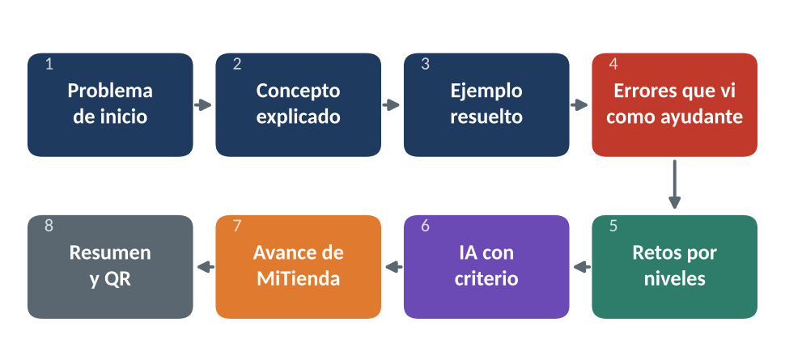
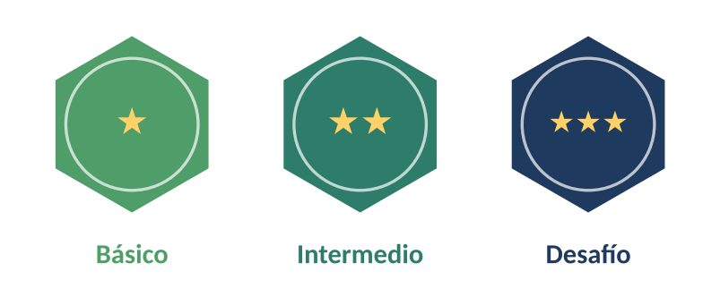
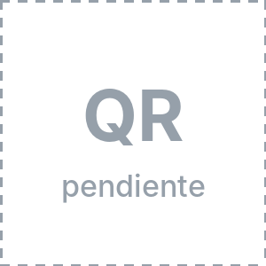

# Cómo usar este libro {#sec-cap0 .unnumbered}

::: {.callout-note .objetivos title="Al terminar este capítulo podrás"}
- Reconocer las secciones que se repiten en cada capítulo y para qué sirve cada una.
- Usar la hoja de progreso para registrar tus insignias.
- Entender qué es MiTienda y cómo vas a construirla.
:::

## Un libro para hacer, no solo para leer

Este es un libro-taller. Puedes leerlo de corrido, pero lo vas a aprovechar de verdad si lo usas con el editor abierto: lee un ejemplo, escríbelo tú (no lo copies y pegues), ejecútalo, cámbialo y observa qué pasa. Programar se aprende como se aprende a andar en bicicleta: viendo a alguien ayuda, pero solo aprendes cuando te subes.

Cada capítulo es corto, de cinco a ocho páginas, y está pensado para trabajarse en una o dos sesiones de estudio. Si un capítulo te toma más tiempo, no pasa nada: los retos tienen niveles justamente para que avances a tu ritmo.

## La estructura de cada capítulo

Todos los capítulos siguen el mismo recorrido. Al repetir la estructura, tu atención queda libre para el contenido y no para adivinar dónde está cada cosa.

{width=100%}

Las secciones especiales aparecen siempre en un recuadro con el mismo color, para que las reconozcas de un vistazo.

| Recuadro | Para qué sirve |
|---|---|
| Problema de inicio | Plantea una situación concreta antes de cualquier definición. Intenta resolverla mentalmente antes de seguir leyendo. |
| Errores que vi como ayudante | Errores reales que se repiten cada semestre, con el mensaje que muestra Python, la causa y la solución. |
| Consejo de ayudante | Atajos, hábitos y trucos que no suelen aparecer en los libros. |
| Reto | Ejercicios en tres niveles. Cada nivel superado te da una insignia. |
| IA con criterio | Cómo usar un asistente de IA para entender, no para copiar. |
| Avance de MiTienda | El paso del proyecto que corresponde a ese capítulo. |

: Recuadros del libro y cuándo usarlos {tbl-colwidths="[28,72]"}


## Retos por niveles e insignias

Cada capítulo termina con tres retos:

- **Básico**: aplicas lo que acabas de ver casi de forma directa. Si no puedes resolverlo, vuelve al ejemplo resuelto.
- **Intermedio**: combinas lo nuevo con lo de capítulos anteriores. Exige pensar antes de escribir.
- **Desafío**: un problema abierto o con una trampa. No es obligatorio, pero es el que más enseña.

Cuando resuelves un reto, marcas su insignia en la hoja de progreso. Usar elementos de juego, como insignias y niveles, en un contexto que no es un juego se conoce como gamificación (Deterding et al., 2011). Aquí la usamos de forma simple, con un objetivo concreto: que veas tu avance y que sepas cuál es tu siguiente paso.

{width=70%}

| Capítulo | Básico | Intermedio | Desafío |
|---|---|---|---|
| 1. Pensar antes de programar | ☐ | ☐ | ☐ |
| 2. Primeros pasos en Python | ☐ | ☐ | ☐ |
| 3. Operadores y expresiones | ☐ | ☐ | ☐ |
| 4. Tomar decisiones | ☐ | ☐ | ☐ |
| 5. Repetir sin repetirse | ☐ | ☐ | ☐ |
| 6. Ordenar el código en funciones | ☐ | ☐ | ☐ |
| 7. Listas y diccionarios | ☐ | ☐ | ☐ |
| 8. Archivos | ☐ | ☐ | ☐ |
| 9. Excepciones y depuración | ☐ | ☐ | ☐ |
| 10. Proyecto MiTienda v1 | ☐ | ☐ | ☐ |

: Hoja de progreso (marca cada reto que resuelvas) {tbl-colwidths="[34,22,22,22]"}


## Retos con autocorrección

Los retos marcados con «autocorregible» tienen pruebas automáticas en el repositorio del libro. Escribes tu solución en el archivo indicado, ejecutas las pruebas y el programa te dice si tu solución es correcta y, si no lo es, en qué caso falla. Es lo más parecido a tener un ayudante revisando tu código a cualquier hora.

Así se ve una prueba por dentro. No necesitas entenderla todavía; basta con que sepas que comprueba tu función con varios casos:

```{python}
# prueba_reto_3_1.py (versión simplificada)
def calcular_vuelto(total, pago):
    return pago - total   # aquí va tu solución

assert calcular_vuelto(37.5, 50) == 12.5
assert calcular_vuelto(20, 20) == 0
print("¡Todas las pruebas pasaron!")
```

## Códigos QR

Al final de cada capítulo hay un código QR que lleva al código completo del capítulo en el repositorio del libro. Desde ahí puedes abrirlo en el navegador, sin instalar nada, y compararlo con tu solución.

::: {.callout-note title="Código QR"}
{width=15%} QR al código del capítulo (se activará cuando el repositorio sea público)
:::

## El proyecto MiTienda

Doña Rosa tiene una tienda de barrio. Anota sus ventas en un cuaderno, calcula los totales con una calculadora y, a fin de mes, no sabe con certeza cuánto vendió ni qué productos se le agotan primero. A lo largo del libro vas a construir **MiTienda**, un programa de consola que la ayuda a registrar productos, hacer ventas y ver reportes.

No lo haces de golpe. En cada capítulo agregas una pieza con lo que acabas de aprender:

| Capítulo | Versión | Qué agrega |
|---|---|---|
| 1 | v0.1 | El algoritmo de una venta, en pseudocódigo. |
| 2 | v0.2 | Pedir los datos de un producto y mostrarlos. |
| 3 | v0.3 | Calcular subtotal, descuento, total y vuelto. |
| 4 | v0.4 | Menú de opciones y reglas de descuento. |
| 5 | v0.5 | Vender varios productos en una misma compra. |
| 6 | v0.6 | Ordenar el código en funciones. |
| 7 | v0.7 | Catálogo de productos con listas y diccionarios. |
| 8 | v0.8 | Guardar las ventas en un archivo. |
| 9 | v0.9 | Resistir datos mal escritos y archivos que faltan. |
| 10 | v1.0 | Programa completo con reportes. |

: Cómo crece MiTienda a lo largo del libro {tbl-colwidths="[16,30,54]"}


En el Libro 2 de esta serie, *Del programa al producto*, este mismo programa se convierte en un producto real: con control de versiones, pruebas, base de datos y publicación.

## Qué necesitas

- Una computadora con Windows, macOS o Linux. Si no tienes una, puedes usar un entorno en el navegador como Google Colab.
- Python 3.12 o superior, que instalarás en el capítulo 2.
- Un cuaderno. En serio: los mejores programadores que conozco piensan en papel antes de escribir código.

::: {.callout-tip .consejo title="Consejo de ayudante"}
No te saltes el capítulo 1 aunque tengas prisa por escribir código. Los estudiantes que más sufren en los parciales casi nunca tienen problemas con la sintaxis: tienen problemas para decidir qué pasos debe seguir su programa.
:::
