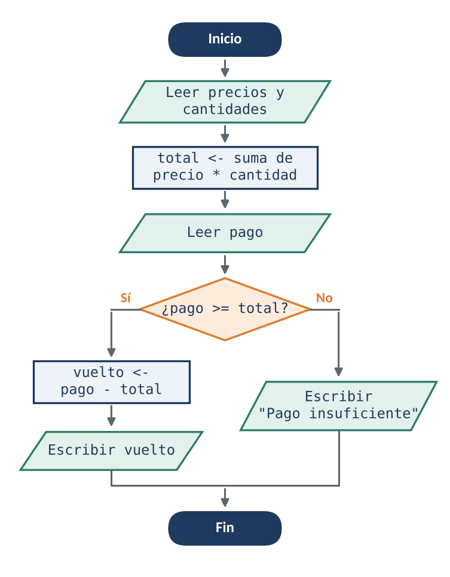

# Pensar antes de programar {#sec-cap1}

::: {.callout-note .objetivos title="Al terminar este capítulo podrás"}
- Distinguir los datos de entrada, el proceso y los datos de salida de un problema.
- Escribir un algoritmo en pseudocódigo y representarlo en un diagrama de flujo.
- Comprobar un algoritmo a mano con una prueba de escritorio antes de programarlo.
:::

::: {.callout-note .problema title="Problema de inicio"}
Un cliente compra 3 panes a 0.50 cada uno y 1 litro de leche a 6.00. Paga con un billete de 20. ¿Cuánto vuelto le corresponde? Ahora la pregunta importante: **¿qué pasos seguiste para saberlo?** Escríbelos en tu cuaderno antes de seguir leyendo.
:::

## Un problema no es lo mismo que una pregunta

Seguramente respondiste rápido: el vuelto es 12.50. Pero si te pido que expliques cómo lo hiciste, aparecen pasos que hiciste sin pensar: multiplicaste el precio de los panes por su cantidad, sumaste la leche, restaste el total del pago. Una computadora no puede «hacerlo sin pensar». Necesita que le digas cada paso, en orden y sin ambigüedad.

Por eso, antes de programar, todo problema se separa en tres partes:

| Parte | En el problema del vuelto |
|---|---|
| Entrada | Los datos que necesitas conocer: precio y cantidad de cada producto, y el monto con el que paga el cliente. |
| Proceso | Lo que haces con esos datos: calcular el total y restarlo del pago. |
| Salida | El resultado que entregas: el vuelto. |

: Análisis del problema del vuelto {tbl-colwidths="[22,78]"}


::: {.callout-tip .consejo title="Consejo de ayudante"}
Si no puedes llenar esta tabla, todavía no entiendes el problema y no estás listo para escribir código. En las clases prácticas, cuando un estudiante me decía «no sé por dónde empezar», casi siempre era porque no tenía claro cuál era la salida que se le pedía.
:::

## ¿Qué es un algoritmo?

Un **algoritmo** es una secuencia finita de pasos, ordenados y sin ambigüedad, que resuelve un problema. Una receta de cocina se parece a un algoritmo, pero tiene frases como «sal al gusto» que una computadora no sabría interpretar.

Un buen algoritmo cumple tres condiciones (Joyanes Aguilar, 2008):

- **Es preciso**: cada paso indica exactamente qué hacer.
- **Es definido**: si lo sigues dos veces con los mismos datos, obtienes el mismo resultado.
- **Es finito**: termina en algún momento.

## Pseudocódigo: escribir el algoritmo en tu idioma

El **pseudocódigo** es una forma de escribir un algoritmo con palabras de nuestro idioma y una estructura parecida a la de un programa. No tiene reglas tan estrictas como un lenguaje de programación, pero obliga a ser ordenado. Este es el algoritmo del vuelto:

```{.text .pseudo}
Algoritmo CalcularVuelto
    Leer precio_pan, cantidad_pan
    Leer precio_leche, cantidad_leche
    Leer pago
    total_pan <- precio_pan * cantidad_pan
    total_leche <- precio_leche * cantidad_leche
    total <- total_pan + total_leche
    vuelto <- pago - total
    Escribir "El vuelto es: ", vuelto
FinAlgoritmo
```

La flecha `<-` se lee «toma el valor de». La línea `total <- ...` significa: calcula lo que está a la derecha y guárdalo con el nombre `total`. Más adelante, en Python, esa flecha se convierte en el signo `=`.

## Diagramas de flujo: el algoritmo en imagen

Un **diagrama de flujo** representa el mismo algoritmo con figuras unidas por flechas. Cada figura tiene un significado:

| Símbolo | Significado |
|---|---|
| Óvalo | Inicio o fin del algoritmo. |
| Paralelogramo | Entrada o salida de datos (Leer, Escribir). |
| Rectángulo | Proceso o cálculo. |
| Rombo | Decisión: una pregunta con respuesta sí o no. |
| Flecha | El orden en que se ejecutan los pasos. |

: Símbolos básicos de un diagrama de flujo {tbl-colwidths="[30,70]"}


Ahora vamos a mejorar el algoritmo. ¿Qué pasa si el cliente paga con menos dinero del que debe? El algoritmo anterior respondería con un vuelto negativo, lo que no tiene sentido. Agregamos una **decisión**:

{width=78%}

## La prueba de escritorio

Una **prueba de escritorio** consiste en ejecutar el algoritmo a mano, paso por paso, anotando el valor de cada variable. Es la herramienta más barata para encontrar errores: no necesitas computadora y la puedes hacer en un examen escrito.

| Caso | total | pago | ¿pago >= total? | vuelto | Salida |
|---|---|---|---|---|---|
| 1 | 7.50 | 20 | Sí | 12.50 | «El vuelto es: 12.50» |
| 2 | 7.50 | 5 | No | — | «Pago insuficiente, faltan 2.50» |

: Prueba de escritorio con dos casos {tbl-colwidths="[12,14,14,12,14,34]"}


Fíjate en que el caso 2 no es un capricho. Cuando pruebas un algoritmo, no basta con el caso «normal»: también hay que probar los casos que pueden romperlo. A esos casos les llamamos **casos límite** y volveremos a ellos en el capítulo 4.

::: {.callout-warning .error title="Errores que vi como ayudante"}
**1. Empezar por el código.** El estudiante abre el editor, escribe la primera línea que se le ocurre y luego intenta «arreglar» el programa hasta que funcione. *Por qué pasa:* da la sensación de avanzar más rápido. *Cómo evitarlo:* escribe primero entrada, proceso y salida, aunque sea en tres líneas.

**2. Pasos ambiguos.** Pseudocódigo como «calcular el total» sin decir cómo. *Por qué pasa:* para ti es obvio. *Cómo evitarlo:* pregúntate si alguien que no conoce el problema podría seguir ese paso sin preguntarte nada.

**3. Probar solo el caso feliz.** La prueba de escritorio se hace con datos donde todo sale bien. *Cómo evitarlo:* agrega siempre al menos un caso límite: cero, un número negativo, un pago insuficiente.
:::

## Retos

::: {.callout-note .reto-basico title="Reto 1.1 · Básico"}
Escribe en pseudocódigo un algoritmo que lea el precio de un producto y la cantidad comprada, y muestre el monto a pagar. Haz su prueba de escritorio con dos casos.
:::

::: {.callout-note .reto-intermedio title="Reto 1.2 · Intermedio"}
Doña Rosa hace un descuento del 10 % si la compra supera 100. Dibuja el diagrama de flujo que lee el total de la compra y muestra el monto final a pagar. Incluye en tu prueba de escritorio un caso con total exactamente igual a 100. ¿Qué debería pasar?
:::

::: {.callout-note .reto-desafio title="Reto 1.3 · Desafío"}
El cajero solo tiene monedas de 5, 2 y 1. Escribe un algoritmo que, dado un vuelto entero, indique cuántas monedas de cada tipo entregar usando la menor cantidad de monedas posible. Pista: piensa en cómo lo harías tú con monedas reales.
:::

::: {.callout-important .ia title="IA con criterio"}
**Úsala para revisar tu razonamiento, no para reemplazarlo.** Primero escribe tu algoritmo. Después pídele al asistente algo como:

*«Soy estudiante de primer semestre. Este es mi algoritmo en pseudocódigo para calcular el vuelto. No me des la solución: dime qué casos de prueba podrían hacer que falle.»*

**Verifica la respuesta:** haz la prueba de escritorio con cada caso que te proponga. Si la IA dice que tu algoritmo falla con un caso, compruébalo a mano antes de creerle. Los asistentes de IA pueden equivocarse con total seguridad, y la investigación muestra que el beneficio para principiantes depende de que sigan razonando por sí mismos (Kazemitabaar et al., 2023).
:::

## Avance de MiTienda (v0.1)

Antes de escribir una sola línea de Python, diseñamos lo que hará MiTienda al registrar una venta de un solo producto:

```{.text .pseudo}
Algoritmo VentaSimple
    Leer nombre_producto, precio, cantidad
    total <- precio * cantidad
    Escribir "Total a pagar: ", total
    Leer pago
    Si pago >= total Entonces
        Escribir "Vuelto: ", pago - total
    SiNo
        Escribir "Pago insuficiente"
    FinSi
FinAlgoritmo
```

Guarda este algoritmo: en los capítulos 2, 3 y 4 lo vas a convertir, pieza por pieza, en un programa real.

::: {.callout-note .resumen title="Resumen"}
- Todo problema se analiza en entrada, proceso y salida antes de programar.
- Un algoritmo es una secuencia finita, precisa y definida de pasos.
- El pseudocódigo y el diagrama de flujo son dos formas de expresar el mismo algoritmo.
- La prueba de escritorio encuentra errores antes de escribir código; incluye siempre casos límite.
:::

::: {.callout-note title="Código QR"}
{width=15%} Versión web del capítulo 1, con el código para copiar: <https://ignaciozdev7.github.io/aprender-haciendo/libro1/cap01.html>
:::
