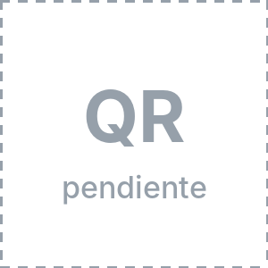

# Operadores y expresiones {#sec-cap3}

::: {.callout-note .objetivos title="Al terminar este capítulo podrás"}
- Usar los operadores aritméticos, incluidos `//`, `%` y `**`.
- Predecir el resultado de una expresión aplicando el orden de precedencia.
- Escribir comparaciones y combinarlas con `and`, `or` y `not`.
- Explicar por qué `0.1 + 0.2` no da exactamente `0.3` y cómo trabajar con dinero sin sorpresas.
:::

::: {.callout-note .problema title="Problema de inicio"}
Doña Rosa vende huevos sueltos, pero también en maples de 30. Un cliente pide 75 huevos. ¿Cuántos maples completos le entrega y cuántos huevos sueltos? Seguramente lo calculaste dividiendo. Ahora piensa: ¿cómo le pides a una computadora **solo la parte entera** de una división, y **solo el resto**?
:::

## Operadores aritméticos

Una **expresión** es una combinación de valores, variables y operadores que Python calcula para obtener un resultado. Estos son los operadores aritméticos:

| Operador | Operación | Ejemplo | Resultado |
|---|---|---|---|
| `+` | Suma | `7 + 2` | `9` |
| `-` | Resta | `7 - 2` | `5` |
| `*` | Multiplicación | `7 * 2` | `14` |
| `/` | División | `7 / 2` | `3.5` (siempre `float`) |
| `//` | División entera | `7 // 2` | `3` |
| `%` | Resto (módulo) | `7 % 2` | `1` |
| `**` | Potencia | `7 ** 2` | `49` |

: Operadores aritméticos de Python {tbl-colwidths="[16,28,18,38]"}


Con `//` y `%` resuelves el problema de inicio:

```{python}
huevos = 75
maples = huevos // 30
sueltos = huevos % 30
print(f"{maples} maples y {sueltos} huevos sueltos")
```

::: {.callout-tip .consejo title="Consejo de ayudante"}
El operador `%` es mucho más útil de lo que parece. Un número `n` es par si `n % 2 == 0`; termina en cero si `n % 10 == 0`. Cuando en un parcial aparece «cada cierto número de…», casi siempre la respuesta pasa por `%`.
:::

## Orden de precedencia

¿Cuánto vale `2 + 3 * 4`? Si respondiste 20, sumaste primero. Python, igual que las matemáticas, multiplica antes de sumar, y el resultado es 14. El orden en que se evalúan los operadores se llama **precedencia** (Python Software Foundation, s. f.-c):

| Orden | Operadores | Ejemplo |
|---|---|---|
| 1 | `( )` paréntesis | `(2 + 3) * 4` vale `20` |
| 2 | `**` potencia | `2 * 3 ** 2` vale `18` |
| 3 | `*`, `/`, `//`, `%` | `10 - 6 / 2` vale `7.0` |
| 4 | `+`, `-` | se evalúan de izquierda a derecha |
| 5 | `==`, `!=`, `<`, `>`, `<=`, `>=` | `1 + 1 == 2` vale `True` |
| 6 | `not` | |
| 7 | `and` | |
| 8 | `or` | |

: Precedencia de operadores, de mayor a menor {tbl-colwidths="[12,40,48]"}


La regla práctica es simple: **si dudas, usa paréntesis.** No cambian el resultado cuando no hacen falta y hacen que tu código se entienda mejor.

## Comparaciones y valores lógicos

Los operadores de comparación preguntan algo y responden con un valor `bool`: `True` (verdadero) o `False` (falso).

```{python}
total = 120
print(total > 100)
print(total == 100)
print(total != 100)
print(0 <= total <= 150)
```

La última línea muestra algo propio de Python: puedes encadenar comparaciones como en matemáticas. `0 <= total <= 150` pregunta si `total` está entre 0 y 150.

Para combinar condiciones se usan los **operadores lógicos**:

| Operador | Es verdadero cuando… | Ejemplo con `total = 120` |
|---|---|---|
| `and` | las dos condiciones son verdaderas | `total > 100 and total < 200` es `True` |
| `or` | al menos una es verdadera | `total < 50 or total > 100` es `True` |
| `not` | la condición es falsa | `not total > 100` es `False` |

: Operadores lógicos {tbl-colwidths="[16,46,38]"}


## Conversión de tipos

En el capítulo 2 usaste `int()` y `float()` para convertir texto en números. También funcionan entre números, y `str()` convierte cualquier valor en texto:

```{python}
print(int(7.9))
print(float(3))
print(str(25) + " unidades")
print(round(7.456, 2))
```

Fíjate en la primera línea: `int()` no redondea, **corta** la parte decimal. Si necesitas redondear, usa `round()`.

## El misterio de 0.1 + 0.2

Prueba esto en Python:

```{python}
print(0.1 + 0.2)
print(0.1 + 0.2 == 0.3)
```

No es un error de Python. Las computadoras guardan los números `float` en binario, y números como 0.1 no tienen una representación binaria exacta, igual que 1/3 no tiene una representación decimal exacta (0.3333…). La documentación oficial de Python dedica una sección completa a este tema (Python Software Foundation, s. f.-a). Por eso, cuando trabajes con dinero:

- Muestra los resultados con dos decimales (`:.2f`) o usa `round(valor, 2)`.
- No compares dos `float` con `==`. Compara si su diferencia es muy pequeña o redondea antes.
- En programas profesionales se usan enteros (centavos) o el módulo `decimal`. En el Libro 2 volveremos a este tema.

::: {.callout-warning .error title="Errores que vi como ayudante"}
**1. Confundir `=` con `==`.** `=` guarda un valor; `==` pregunta si dos valores son iguales. Escribir `total = 100` cuando querías preguntar si el total es 100 es probablemente el error que más corregí en mis años de ayudante. En el capítulo 4 verás qué mensaje muestra Python cuando ocurre dentro de un `if`.

**2. Convertir a `int` un texto con decimales.**

```{.python .error}
precio = int("12.5")
```

```{.text .salida}
ValueError: invalid literal for int() with base 10: '12.5'
```

*Por qué pasa:* `int()` solo acepta textos que representan un entero. *Solución:* usa `float("12.5")` y, si necesitas un entero, convierte después: `int(float("12.5"))`.

**3. Dividir entre cero.** `total / cantidad` funciona hasta el día en que alguien ingresa `0` como cantidad. Python se detiene con `ZeroDivisionError: division by zero`. En el capítulo 4 aprenderás a comprobarlo antes de dividir.

**4. Olvidar la precedencia.** Para calcular el promedio de dos notas, `n1 + n2 / 2` divide solo la segunda nota. Lo correcto es `(n1 + n2) / 2`.
:::

## Retos

::: {.callout-note .reto-basico title="Reto 3.1 · Básico · autocorregible"}
Escribe un programa que pida el total de una compra y el monto pagado, y muestre el vuelto con dos decimales. (Es el reto cuya prueba viste en el capítulo 0.)
:::

::: {.callout-note .reto-intermedio title="Reto 3.2 · Intermedio"}
Pide una cantidad de minutos y muéstrala en horas y minutos. Por ejemplo, `135` debe mostrar `2 h 15 min`. Usa `//` y `%`.
:::

::: {.callout-note .reto-desafio title="Reto 3.3 · Desafío"}
Sin ejecutarlas, calcula el valor de estas expresiones. Después compruébalas en Python y explica cada diferencia con tu predicción: `-2 ** 2`, `7 // -2`, `not 3 > 2 and 2 > 3`, `round(2.675, 2)`. Pista para la última: relee la sección 3.5.
:::

::: {.callout-important .ia title="IA con criterio"}
**Pídele ejercicios, no respuestas.** Un buen uso de la IA es generar práctica a tu medida:

*«Dame 5 expresiones de Python con operadores aritméticos y lógicos para que yo calcule su resultado a mano. No me des las respuestas hasta que te las pida.»*

**Verifica la respuesta:** cuando la IA te dé las soluciones, no las aceptes sin más: ejecuta cada expresión en Python. Python es la autoridad final, no el asistente. Más de una vez vas a encontrar que la IA se equivocó, sobre todo con la precedencia y con los `float`.
:::

## Avance de MiTienda (v0.3)

Ahora MiTienda calcula. Agregamos un descuento fijo del 5 % y el vuelto. Guardamos el porcentaje en una variable en mayúsculas, que por convención indica un valor que no cambia durante el programa (una **constante**):

```python
# MiTienda v0.3: calcular el total y el vuelto
DESCUENTO = 0.05   # 5 %

nombre = input("Producto: ")
precio = float(input("Precio unitario: "))
cantidad = int(input("Cantidad: "))

subtotal = precio * cantidad
descuento = round(subtotal * DESCUENTO, 2)
total = subtotal - descuento
print(f"Subtotal:  {subtotal:8.2f}")
print(f"Descuento: {descuento:8.2f}")
print(f"Total:     {total:8.2f}")

pago = float(input("Paga con: "))
print(f"Vuelto:    {pago - total:8.2f}")
```

```{.text .salida}
Producto: Arroz 1 kg
Precio unitario: 2.5
Cantidad: 4
Subtotal:     10.00
Descuento:     0.50
Total:         9.50
Paga con: 20
Vuelto:       10.50
```

El `8` en `:8.2f` reserva 8 espacios para el número, para que las cifras queden alineadas como en un ticket. Todavía hay un problema: si el cliente paga con menos dinero, el vuelto sale negativo. Lo resolveremos en el próximo capítulo.

::: {.callout-note .resumen title="Resumen"}
- `/` siempre da `float`; `//` da la parte entera y `%` el resto.
- La precedencia decide el orden de cálculo; ante la duda, usa paréntesis.
- Las comparaciones devuelven `True` o `False` y se combinan con `and`, `or` y `not`.
- Los `float` no son exactos: redondea al mostrar y no los compares con `==`.
:::

::: {.callout-note title="Código QR"}
{width=15%} Código y soluciones del capítulo 3
:::
