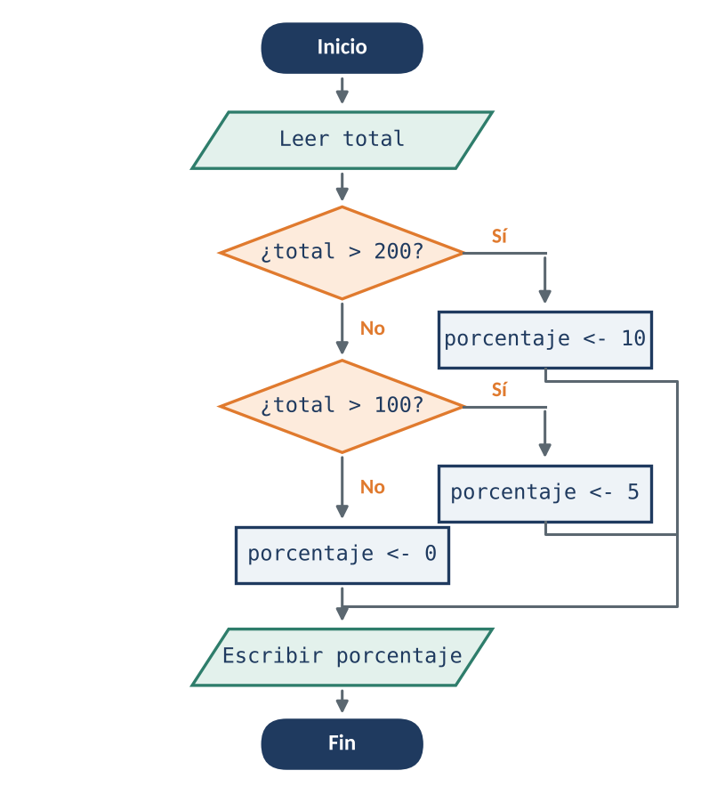

# Tomar decisiones {#sec-cap4}

::: {.callout-note .objetivos title="Al terminar este capítulo podrás"}
- Escribir decisiones con `if`, `elif` y `else`, respetando la indentación.
- Combinar condiciones y ordenar varias alternativas sin que se pisen entre sí.
- Diseñar casos de prueba que incluyan los casos límite.
:::

::: {.callout-note .problema title="Problema de inicio"}
Doña Rosa decidió premiar a sus clientes: si la compra supera 200, hace un 10 % de descuento; si supera 100, un 5 %; si no, nada. Un cliente compra exactamente 200. ¿Qué descuento le corresponde? Si dudaste, acabas de descubrir por qué las decisiones son la parte del código donde más errores se esconden.
:::

## La instrucción if

Hasta ahora, tus programas ejecutaban todas sus líneas, de arriba hacia abajo. Con `if` (en español, «si») el programa ejecuta un bloque de código **solo si** se cumple una condición:

```python
pago = float(input("Paga con: "))
total = 7.5
if pago < total:
    print("Pago insuficiente")
print("Gracias por su compra")
```

```{.text .salida}
Paga con: 5
Pago insuficiente
Gracias por su compra
```

Dos detalles de sintaxis que no son opcionales:

- La línea del `if` termina con **dos puntos** (`:`).
- El bloque que depende del `if` va **indentado**, es decir, con una sangría de 4 espacios. La indentación no es estética: en Python, es la forma de decir qué líneas pertenecen al `if`. La última línea, sin sangría, se ejecuta siempre.

## if y else: dos caminos

Con `else` («si no») indicas qué hacer cuando la condición es falsa. Es exactamente el rombo del diagrama de flujo del capítulo 1: una pregunta con dos salidas.

```python
total = 7.5
pago = float(input("Paga con: "))
if pago >= total:
    print(f"Vuelto: {pago - total:.2f}")
else:
    print(f"Faltan {total - pago:.2f}")
```

```{.text .salida}
Paga con: 20
Vuelto: 12.50
```

## elif: varias alternativas

Cuando hay más de dos caminos, se usa `elif` (contracción de «else if»). Python revisa las condiciones **en orden, de arriba hacia abajo, y ejecuta solo el primer bloque cuya condición sea verdadera**. Los demás se saltan. Así se resuelve el problema de inicio:

```python
total = float(input("Total de la compra: "))
if total > 200:
    porcentaje = 10
elif total > 100:
    porcentaje = 5
else:
    porcentaje = 0
print(f"Descuento: {porcentaje} %")
```

```{.text .salida}
Total de la compra: 200
Descuento: 5 %
```

Una compra de exactamente 200 no **supera** 200, así que recibe el 5 %. Si Doña Rosa quisiera incluir el 200, la condición debería ser `total >= 200`. Esa diferencia de un solo carácter es la que separa un programa correcto de uno que le cobra mal a un cliente.

{width=80%}

## Condiciones compuestas y decisiones anidadas

Puedes combinar condiciones con `and`, `or` y `not`, que viste en el capítulo 3:

```{python}
cantidad = 12
es_mayorista = True
if cantidad >= 10 and es_mayorista:
    print("Aplica precio mayorista")
```

También puedes poner un `if` dentro de otro (decisiones **anidadas**). Úsalas con moderación: más de dos niveles de sangría suelen ser señal de que el problema se puede plantear mejor con `elif` o con condiciones compuestas.

## Diseñar casos de prueba

En el capítulo 1 dijimos que no basta con probar el caso feliz. Ahora lo hacemos de forma sistemática. Para la regla de descuentos, los valores interesantes están en las **fronteras**: justo antes, justo en y justo después de 100 y de 200.

| Total | Esperado | Obtenido | Por qué lo probamos |
|---|---|---|---|
| 50 | 0 % | 0 % | Caso normal sin descuento |
| 100 | 0 % | 0 % | Frontera exacta: no supera 100 |
| 100.01 | 5 % | 5 % | Justo después de la frontera |
| 200 | 5 % | 5 % | Frontera exacta: no supera 200 |
| 250 | 10 % | 10 % | Caso normal con descuento máximo |
| -10 | Error | 0 % | Dato inválido: ¡el programa no lo detecta! |

: Casos de prueba para la regla de descuentos {tbl-colwidths="[20,22,22,36]"}


La última fila es la más valiosa: encontró un problema real. Un total negativo no tiene sentido, y el programa lo acepta sin quejarse. Detectar estos casos es exactamente para lo que sirven las pruebas. En el avance de MiTienda vas a ver cómo validarlo.

::: {.callout-warning .error title="Errores que vi como ayudante"}
**1. Usar `=` en lugar de `==` dentro de un `if`.**

```{.python .error}
opcion = 1
if opcion = 1:
    print("Vender")
```

```{.text .salida}
SyntaxError: invalid syntax. Maybe you meant '==' or ':=' instead of '='?
```

*Cómo leerlo:* Python incluso te sugiere la solución. `==` compara; `=` asigna.

**2. Olvidar la indentación.**

```{.text .salida}
IndentationError: expected an indented block after 'if' statement on line 2
```

*Por qué pasa:* el bloque del `if` quedó sin sangría. *Consejo:* configura tu editor para que la tecla Tab inserte 4 espacios.

**3. Ordenar mal los `elif`.** Si escribes primero `if total > 100` y después `elif total > 200`, la segunda condición nunca se cumple: cualquier total mayor que 200 también es mayor que 100 y entra al primer bloque. *Regla:* ordena de la condición más restrictiva a la menos restrictiva.

**4. Comparar textos sin pensar en mayúsculas.** `"Si" == "si"` es `False`. Si el usuario responde una pregunta, normaliza su respuesta con `.lower()` antes de comparar: `respuesta.lower() == "si"`.
:::

::: {.callout-tip .consejo title="Consejo de ayudante"}
Antes de escribir un `if` con varias alternativas, dibuja una recta numérica y marca las fronteras. Te tomará veinte segundos y te ahorrará la mitad de los errores de este capítulo.
:::

## Retos

::: {.callout-note .reto-basico title="Reto 4.1 · Básico · autocorregible"}
Pide un número entero e indica si es par o impar. Pista: el operador `%` del capítulo 3.
:::

::: {.callout-note .reto-intermedio title="Reto 4.2 · Intermedio"}
Pide una nota de 0 a 100 y muestra «Reprobado» (menos de 51), «Aprobado» (51 a 79) o «Excelente» (80 o más). Si la nota está fuera del rango, muestra «Nota inválida». Escribe primero tu tabla de casos de prueba con todas las fronteras.
:::

::: {.callout-note .reto-desafio title="Reto 4.3 · Desafío"}
Pide tres longitudes e indica si pueden formar un triángulo y, si pueden, si es equilátero, isósceles o escaleno. Recuerda que en un triángulo cada lado debe ser menor que la suma de los otros dos. ¿Cuántos casos de prueba necesitas como mínimo para estar seguro de tu programa?
:::

::: {.callout-important .ia title="IA con criterio"}
**Pídele casos de prueba para tu código, no código para tus casos.** Cuando termines un reto:

*«Este es mi programa para el reto de las notas. Propón casos de prueba que puedan hacerlo fallar, incluyendo fronteras y datos inválidos. No corrijas el código.»*

**Verifica la respuesta:** ejecuta tu programa con cada caso y anota el resultado en tu tabla. Si un caso falla, corrígelo tú. Un estudio con estudiantes principiantes encontró que quienes usaron un generador de código durante la práctica no rindieron peor al programar después sin él, y que los que más aprovecharon fueron los que ya tenían una base previa (Kazemitabaar et al., 2023). La base, entonces, sigue siendo tuya.
:::

## Avance de MiTienda (v0.4)

MiTienda ya tiene un menú, aplica la regla de descuentos y no acepta pagos insuficientes ni datos inválidos:

```python
# MiTienda v0.4: menú y reglas de descuento
print("=== MiTienda ===")
print("1. Registrar venta")
print("2. Salir")
opcion = input("Elige una opción: ")

if opcion == "1":
    nombre = input("Producto: ")
    precio = float(input("Precio unitario: "))
    cantidad = int(input("Cantidad: "))

    if precio <= 0 or cantidad <= 0:
        print("Error: precio y cantidad deben ser positivos")
    else:
        subtotal = precio * cantidad
        if subtotal > 200:
            porcentaje = 10
        elif subtotal > 100:
            porcentaje = 5
        else:
            porcentaje = 0
        total = subtotal * (1 - porcentaje / 100)
        print(f"{cantidad} x {nombre}: {subtotal:.2f}")
        print(f"Descuento {porcentaje} %. Total: {total:.2f}")
elif opcion == "2":
    print("Hasta pronto")
else:
    print("Opción no válida")
```

```{.text .salida}
=== MiTienda ===
1. Registrar venta
2. Salir
Elige una opción: 1
Producto: Queso
Precio unitario: 45
Cantidad: 3
3 x Queso: 135.00
Descuento 5 %. Total: 128.25
```

Observa que la opción del menú se compara con el texto `"1"` y no con el número `1`, porque `input()` devuelve texto. Por ahora el programa termina después de una venta. En el capítulo 5 aprenderás a repetir el menú hasta que el usuario elija salir.

::: {.callout-note .resumen title="Resumen"}
- `if` ejecuta un bloque solo si la condición es verdadera; `else` cubre el caso contrario.
- Con `elif`, Python ejecuta solo el primer bloque verdadero: el orden importa.
- La indentación de 4 espacios define qué líneas pertenecen a cada bloque.
- Prueba siempre las fronteras y los datos inválidos.
:::

::: {.callout-note title="Código QR"}
{width=15%} Versión web del capítulo 4, con el código para copiar: <https://ignaciozdev7.github.io/aprender-haciendo/libro1/cap04.html>
:::
