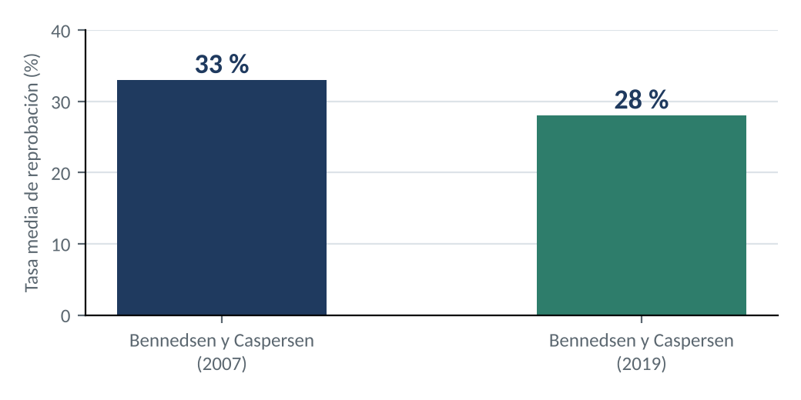

# Antes de empezar {.unnumbered}

Este libro nació en un aula. Durante varios años fui ayudante de cátedra de las materias iniciales de programación y cada semestre vi la misma escena: estudiantes que entendían la clase, pero que se quedaban en blanco frente a una pantalla vacía; estudiantes que escribían un programa entero y no sabían qué hacer cuando aparecía el primer mensaje de error en rojo.

No es un problema solo de nuestra carrera. Los estudios internacionales sobre cursos introductorios de programación reportan que aproximadamente uno de cada cuatro o cinco estudiantes no aprueba su primer curso. Bennedsen y Caspersen (2007) estimaron una tasa media de reprobación del 33 % y, doce años después, la volvieron a medir en un 28 % (Bennedsen y Caspersen, 2019). Watson y Li (2014) llegaron a una conclusión parecida al revisar datos de cursos de distintos países.

{width=85%}

La investigación también explica parte del porqué. Robins et al. (2003) observaron que lo que separa a un principiante que avanza de uno que se estanca no es tanto lo que sabe del lenguaje, sino sus **estrategias**: cómo descompone un problema, cómo sigue la ejecución de su programa y qué hace cuando algo falla. Por eso este libro no empieza por la sintaxis, sino por la forma de pensar un problema, y por eso cada capítulo dedica espacio a los errores.

## Lo que encontrarás aquí

- Un **problema real** al inicio de cada capítulo, antes de cualquier definición.
- **Ejemplos resueltos** paso a paso. Estudiar ejemplos resueltos reduce la carga mental del principiante frente a resolver todo desde cero (Sweller, 1988).
- Los **errores que vi como ayudante**: los que se repiten cada semestre, con su causa y su solución.
- **Retos por niveles** (Básico, Intermedio y Desafío) con insignias para registrar tu progreso.
- La sección **IA con criterio**, para aprender con asistentes de IA sin que piensen por ti. La IA generativa ya cambió la forma en que se enseña y se aprende a programar, y la comunidad de educación en computación está discutiendo cómo adaptarse (Denny et al., 2024; Prather et al., 2023).
- **MiTienda**, un programa que crece contigo de capítulo en capítulo.

::: {.callout-caution .nota title="Sobre el uso de inteligencia artificial en este libro"}
Este libro se escribió con apoyo de asistentes de IA para preparar borradores, revisar la redacción y detectar errores en el código. Todo el contenido fue revisado, probado y adaptado por el autor, y cada ejemplo de código se ejecutó antes de incluirse. Declaro este uso por la misma razón por la que te pido que declares el tuyo: la honestidad sobre cómo se produce un trabajo es parte del trabajo.
:::

Ignacio Zárate
