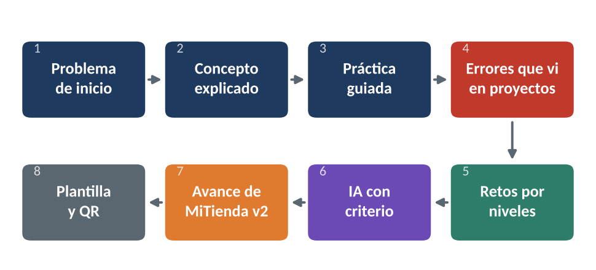

# Cómo usar este libro {#sec-cap0 .unnumbered}

::: {.callout-note .objetivos title="Al terminar este capítulo podrás"}
- Describir el punto de partida del libro: MiTienda v1.
- Explicar qué le falta a un programa para convertirse en un producto.
- Preparar tu computadora para las prácticas.
:::

## El punto de partida: MiTienda v1

Al final del Libro 1 construiste MiTienda v1: un programa de consola que registra las ventas de la tienda de Doña Rosa y las guarda en un archivo. Este es su núcleo, simplificado:

```{python}
# MiTienda v1.0 (resultado del Libro 1), núcleo simplificado
import csv
from datetime import datetime

ARCHIVO_VENTAS = "ventas.csv"
CATALOGO = {"pan": 0.5, "leche": 6.0, "queso": 45.0, "arroz": 9.5}

def guardar_venta(producto, cantidad, importe):
    fecha = datetime.now().strftime("%Y-%m-%d %H:%M")
    with open(ARCHIVO_VENTAS, "a", newline="", encoding="utf-8") as f:
        csv.writer(f).writerow([fecha, producto, cantidad, importe])

def total_vendido(filas):
    return round(sum(float(fila[3]) for fila in filas), 2)
```

Funciona. Doña Rosa puede usarlo. Pero imagina que su sobrino y dos amigos quieren mejorarlo juntos, que Doña Rosa pide un reporte nuevo cada semana y que un día el programa borra por error las ventas del mes. Ahí aparece la diferencia entre un programa y un producto.

## Qué le falta para ser un producto

| Problema | Qué lo resuelve | Capítulo |
|---|---|---|
| No hay historial de cambios; si algo se rompe, no se puede volver atrás. | Control de versiones con Git | 2 |
| Varias personas no pueden trabajar a la vez sin pisarse. | Ramas y *pull requests* en GitHub | 2 |
| Nadie escribió qué debe hacer el programa ni cuándo está «terminado». | Historias de usuario y criterios de aceptación | 3 |
| El equipo no sabe quién hace qué ni qué falta. | Tablero de tareas y método ágil | 4 |
| El código creció sin orden. | Diseño, código limpio y refactorización | 5 y 6 |
| Solo se prueba «a mano», cuando alguien se acuerda. | Pruebas automatizadas con pytest | 7 |
| Los datos viven en un archivo que se puede corromper. | Base de datos SQLite | 8 |
| Para usarlo hay que copiar archivos a mano. | Integración continua y publicación | 9 |

: Lo que le falta a MiTienda v1 y dónde lo resolvemos {tbl-colwidths="[36,40,24]"}


Al final del libro, en el capítulo 10, MiTienda v2 tendrá todo eso. Y lo más importante: tú habrás practicado cada paso.

## Cómo está organizado cada capítulo

Los capítulos siguen la misma estructura que en el Libro 1, con dos cambios. Los recuadros de errores ahora recogen **errores que vi en proyectos de estudiantes**, no solo errores de código. Y cada capítulo termina con una **plantilla** que puedes copiar para los proyectos de tus otras materias.

{width=100%}

## Trabajar solo o en equipo

Las prácticas están pensadas para equipos de tres a cinco personas, porque los problemas que resuelve este libro aparecen cuando hay más de una persona trabajando. Si estudias solo, puedes hacerlas igual: simula los roles y revisa tu propio trabajo al día siguiente, con ojos frescos. Los retos marcados con «en equipo» indican cómo repartir el trabajo.

## Qué necesitas

- Haber terminado el Libro 1, o saber programar en Python funciones, listas, diccionarios y archivos.
- Python 3.12 o superior y un editor como Visual Studio Code.
- **Git**, que instalarás en el capítulo 2, y una cuenta gratuita en **GitHub**.

::: {.callout-tip .consejo title="Consejo de ayudante"}
Crea la cuenta de GitHub con un nombre de usuario profesional, porque la vas a usar durante toda la carrera. Tu perfil de GitHub es lo primero que muchos reclutadores revisan antes de una entrevista de prácticas.
:::
