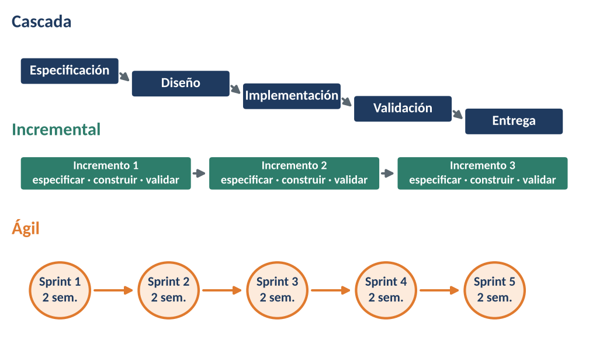

# Del programa al producto {#sec-cap1}

::: {.callout-note .objetivos title="Al terminar este capítulo podrás"}
- Distinguir un programa de un producto de software.
- Describir las actividades fundamentales del proceso de software.
- Comparar el modelo en cascada, el incremental y el ágil, y elegir uno para un proyecto de estudiantes.
- Repartir roles en un equipo de forma explícita.
:::

::: {.callout-note .problema title="Problema de inicio"}
Faltan dos semanas para entregar el proyecto final. El equipo tiene cuatro integrantes y un grupo de chat. Nadie sabe exactamente qué partes están terminadas, dos personas programaron la misma función de forma distinta y el docente acaba de pedir un cambio en el menú. ¿Qué le faltó a este equipo? Anota tres cosas antes de seguir.
:::

## Programa y producto

Un **programa** resuelve un problema para quien lo escribió. Un **producto de software** resuelve un problema para otras personas, y por eso debe cumplir condiciones que un programa personal no necesita: alguien distinto del autor debe poder instalarlo, usarlo, entenderlo y modificarlo, y debe seguir funcionando cuando cambian las necesidades.

Sommerville (2011) define la ingeniería de software como la disciplina que se ocupa de todos los aspectos de la producción de software, desde la especificación inicial hasta su mantenimiento cuando ya está en uso. La palabra clave es **todos**: escribir código es solo una parte del trabajo.

| Aspecto | MiTienda v1 (programa) | MiTienda v2 (producto) |
|---|---|---|
| Quién lo usa | Quien lo escribió y Doña Rosa | Cualquier tienda que lo instale |
| Quién lo modifica | Una persona | Un equipo, al mismo tiempo |
| Cómo se sabe qué debe hacer | Está en la cabeza del autor | Historias de usuario escritas |
| Cómo se sabe que funciona | Se prueba a mano | Pruebas automatizadas |
| Qué pasa si algo se rompe | Se pierde trabajo | Se vuelve a una versión anterior |

: Diferencias entre MiTienda v1 y lo que será MiTienda v2 {tbl-colwidths="[28,36,36]"}

## Las cuatro actividades del proceso de software

Todo proceso de desarrollo, sea cual sea el método, incluye cuatro actividades fundamentales (Sommerville, 2011):

1. **Especificación:** definir qué debe hacer el software y con qué restricciones.
2. **Diseño e implementación:** decidir cómo se organiza y escribir el código.
3. **Validación:** comprobar que hace lo que el usuario necesita.
4. **Evolución:** modificarlo cuando cambian las necesidades.

En los proyectos de materia, casi todo el tiempo se va en la actividad 2. La especificación se reduce a leer el enunciado una vez, la validación ocurre la noche anterior y la evolución no existe porque el proyecto se abandona después de la nota. Este libro dedica un capítulo a cada actividad que suele quedar afuera.

## Tres formas de organizar el trabajo

Un **modelo de proceso** es la forma en que se ordenan esas actividades en el tiempo. Los tres más conocidos son:

{width=100%}

| | Cascada | Incremental | Ágil |
|---|---|---|---|
| Idea central | Planificar todo y luego ejecutar en fases. | Entregar el sistema en partes funcionales. | Ciclos cortos, entregas frecuentes y adaptación al cambio. |
| Cuándo encaja | Requisitos estables y conocidos de antemano. | Requisitos claros que se pueden dividir. | Requisitos que cambian o se descubren en el camino. |
| Riesgo principal | Descubrir los problemas al final. | Que las partes no encajen al integrarlas. | Perder el rumbo si no hay disciplina. |
| En un semestre | Poco recomendable: el docente cambia cosas. | Funciona bien. | Funciona bien con un tablero y reuniones cortas. |

: Comparación de modelos para un proyecto de estudiantes {tbl-colwidths="[22,26,26,26]"}

El **Manifiesto por el Desarrollo Ágil de Software** (Beck et al., 2001) resume la filosofía ágil en cuatro valores: individuos e interacciones sobre procesos y herramientas; software funcionando sobre documentación extensiva; colaboración con el cliente sobre negociación contractual; y respuesta ante el cambio sobre seguir un plan. Ojo: el manifiesto aclara que los elementos de la derecha también tienen valor. Ágil no significa «sin documentación» ni «sin plan».

::: {.callout-tip .consejo title="Consejo de ayudante"}
Para un proyecto de materia de diez a quince semanas recomiendo un modelo incremental con prácticas ágiles: dividir el proyecto en entregas de dos semanas, cada una con algo que funcione y se pueda mostrar. Así, si algo sale mal, siempre tienes una versión anterior que sí funciona para entregar.
:::

## Roles en un equipo de estudiantes

En los equipos de estudiantes, los roles suelen quedar implícitos: quien sabe más programa y los demás «ayudan». Ese reparto concentra el riesgo en una persona y deja a las demás sin aprender. Un reparto explícito, aunque sea simple, cambia la dinámica:

| Rol | Responsabilidad | Rota cada |
|---|---|---|
| Responsable del producto | Mantiene la lista de historias de usuario y decide prioridades con el «cliente» (el docente). | Todo el proyecto |
| Facilitador | Organiza las reuniones cortas, cuida el tablero y detecta bloqueos. | Entrega |
| Desarrolladores | Todos programan, incluidos los dos roles anteriores. | — |
| Revisor de turno | Revisa los *pull requests* de los demás antes de integrarlos. | Semana |

: Roles mínimos para un equipo de 3 a 5 personas {tbl-colwidths="[24,46,30]"}

La rotación es intencional: que todas las personas pasen por revisar código es la forma más rápida de que el conocimiento del proyecto no quede en una sola cabeza.

::: {.callout-warning .error title="Errores que vi como ayudante"}
**1. El héroe de la última noche.** Una persona integra y arregla todo el día antes de la entrega. *Por qué pasa:* nadie integró el trabajo antes. *Cómo evitarlo:* integra en cada entrega parcial, no al final.

**2. «Ya casi está».** Nadie puede decir qué está terminado porque no hay una definición de terminado. *Cómo evitarlo:* acuerden en la primera reunión qué significa «terminado»: funciona, está en el repositorio, alguien más lo revisó y cumple sus criterios de aceptación (capítulo 3).

**3. Elegir el método por su nombre.** El equipo dice que usa Scrum, pero solo hace una reunión el día antes de la entrega. *Cómo evitarlo:* elige pocas prácticas y cúmplelas de verdad, en lugar de muchas de nombre.
:::

## Retos

::: {.callout-note .reto-basico title="Reto 1.1 · Básico"}
Toma un proyecto que hayas entregado en otra materia y clasifica en qué actividad (especificación, diseño e implementación, validación o evolución) pasaste más tiempo y en cuál menos. ¿Qué consecuencias tuvo?
:::

::: {.callout-note .reto-intermedio title="Reto 1.2 · Intermedio · en equipo"}
Para MiTienda v2, decidan qué modelo de proceso usarán y justifíquenlo en un párrafo con la tabla 1.2. Asignen los roles de la tabla 1.3 y escriban cuándo rotan.
:::

::: {.callout-note .reto-desafio title="Reto 1.3 · Desafío"}
El problema de inicio describe un equipo con tres fallas. Para cada una, propón una práctica concreta de este capítulo que la habría evitado y una forma de comprobar, a mitad de semestre, que el equipo la está cumpliendo.
:::

::: {.callout-important .ia title="IA con criterio"}
**Úsala como cliente simulado, no como jefe de proyecto.** Un asistente de IA puede hacer de «Doña Rosa» para que practiques cómo descubrir requisitos:

*«Actúa como la dueña de una tienda de barrio que quiere un programa de ventas. No sabes nada de programación. Responde solo lo que te pregunte, como lo haría una persona real.»*

**Verifica la respuesta:** la IA inventa con seguridad. Lo que obtengas es práctica para hacer preguntas, no requisitos reales: los requisitos de tu proyecto se validan con tu cliente real, que en una materia suele ser el docente.
:::

## Avance de MiTienda v2: el plan

El primer paso hacia el producto no es escribir código, sino decidir cómo trabajará el equipo. Este es el plan de MiTienda v2 que seguiremos en el libro:

| Entrega | Semanas | Resultado que se puede mostrar |
|---|---|---|
| 1 | 1–2 | Repositorio en GitHub con MiTienda v1 y reglas de trabajo (cap. 2). |
| 2 | 3–4 | Historias de usuario priorizadas y tablero de tareas (cap. 3 y 4). |
| 3 | 5–6 | Diseño en capas y código limpio, sin cambiar lo que hace (cap. 5 y 6). |
| 4 | 7–8 | Pruebas automatizadas y base de datos SQLite (cap. 7 y 8). |
| 5 | 9–10 | Integración continua y versión publicada: MiTienda v2 (cap. 9 y 10). |

: Plan de entregas de MiTienda v2 {tbl-colwidths="[16,34,50]"}

::: {.callout-note .resumen title="Resumen"}
- Un producto de software debe poder ser usado, entendido y modificado por personas distintas de su autor.
- El proceso de software tiene cuatro actividades: especificación, diseño e implementación, validación y evolución.
- Cascada, incremental y ágil ordenan esas actividades de forma distinta; en un semestre conviene trabajar por entregas cortas.
- Los roles explícitos y rotativos reparten el trabajo y el conocimiento.
:::

::: {.callout-note title="Código QR"}
{width=15%} Plantilla de plan de entregas y reparto de roles
:::
