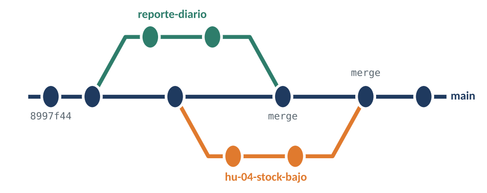
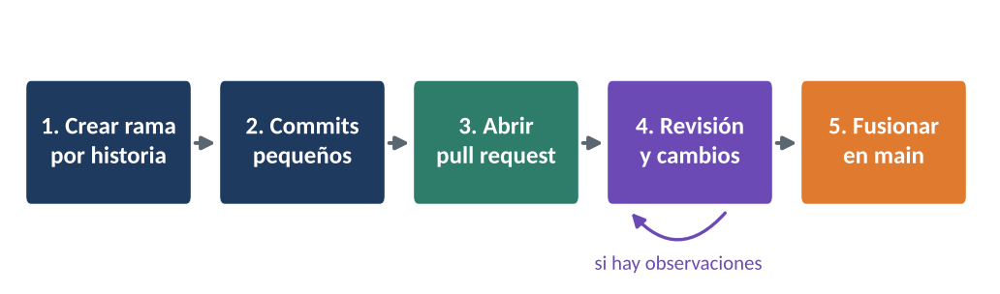

# Git y GitHub {#sec-cap2}

::: {.callout-note .objetivos title="Al terminar este capítulo podrás"}
- Explicar para qué sirve un sistema de control de versiones.
- Crear un repositorio, registrar cambios con *commits* y escribir buenos mensajes.
- Trabajar en ramas y fusionarlas, incluido resolver un conflicto.
- Proponer cambios con un *pull request* y revisar el código de otra persona.
:::

::: {.callout-note .problema title="Problema de inicio"}
En la carpeta del proyecto hay cinco archivos: `mitienda.py`, `mitienda_final.py`, `mitienda_final2.py`, `mitienda_final_REVISADO.py` y `mitienda_juan.py`. El docente pide volver a la versión que funcionaba hace una semana. ¿Cuál es? ¿Qué cambió entre ellas? ¿Quién hizo cada cambio?
:::

## Qué es el control de versiones

Un **sistema de control de versiones** registra los cambios que se hacen a un conjunto de archivos a lo largo del tiempo, de modo que puedes recuperar cualquier versión anterior, ver qué cambió, cuándo y quién lo hizo (Chacon y Straub, 2014). **Git** es el sistema de control de versiones más usado hoy, y **GitHub** es un servicio web que guarda repositorios de Git y agrega herramientas para colaborar.

Git y GitHub no son lo mismo: Git funciona en tu computadora, incluso sin internet; GitHub es uno de los lugares donde puedes publicar tu repositorio para compartirlo.

| Concepto | Qué es |
|---|---|
| Repositorio | La carpeta del proyecto más su historial completo de cambios (guardado en la subcarpeta oculta `.git`). |
| Commit | Una «foto» del proyecto en un momento dado, con un mensaje que explica qué cambió y por qué. |
| Área de preparación | La lista de cambios que entrarán en el próximo commit. Se llena con `git add`. |
| Rama | Una línea de trabajo independiente. La principal suele llamarse `main`. |
| Remoto | Una copia del repositorio en otro lugar, por ejemplo en GitHub. |

: Conceptos básicos de Git {tbl-colwidths="[26,74]"}


## Tu primer repositorio

Instala Git desde git-scm.com. Después, configura tu nombre y tu correo una sola vez; Git los usará para firmar cada commit:

```{.bash .terminal}
$ git config --global user.name "Ana Pérez"
$ git config --global user.email "ana@ejemplo.com"
```

Entra en la carpeta de MiTienda y crea el repositorio:

```{.bash .terminal}
$ git init -b main
Initialized empty Git repository in /home/ana/mitienda/.git/
$ git status
On branch main

No commits yet

Untracked files:
  (use "git add <file>..." to include in what will be committed)
	__pycache__/
	mitienda.py
```

`git status` es el comando que más vas a usar: te dice en qué rama estás y qué archivos cambiaron. Aquí aparecen dos archivos sin seguimiento (*untracked*). Uno es tu programa; el otro, `__pycache__/`, es una carpeta que Python genera automáticamente y que **no** debe guardarse en el repositorio. Para que Git la ignore, crea un archivo llamado `.gitignore`:

```text
# .gitignore para proyectos de Python
__pycache__/
*.pyc
.venv/
ventas.csv
```

También ignoramos `ventas.csv`, porque son datos de la tienda, no código. Ahora sí, guardamos la primera versión en dos pasos: preparar con `git add` y registrar con `git commit`:

```{.bash .terminal}
$ git add mitienda.py .gitignore
$ git commit -m "Agrega MiTienda v1 del Libro 1"
[main (root-commit) 8997f44] Agrega MiTienda v1 del Libro 1
 2 files changed, 23 insertions(+)
 create mode 100644 .gitignore
 create mode 100644 mitienda.py
```

El código `8997f44` es el identificador del commit. En tu computadora será distinto, porque se calcula a partir del contenido, la fecha y el autor.

::: {.callout-caution .nota title="Sobre el idioma de los mensajes"}
Git muestra sus mensajes en el idioma de tu sistema. En este libro aparecen en inglés, que es como se ven en la mayoría de las instalaciones y en la documentación. El significado es el mismo.
:::

## Buenos mensajes de commit

Un commit es una nota para tu equipo y para tu «yo» del futuro. Compara estos historiales:

| Malo | Bueno |
|---|---|
| `cambios` | `Agrega reporte de productos vendidos` |
| `arreglos varios` | `Corrige el total cuando la cantidad es cero` |
| `ahora sí funciona` | `Valida que el precio sea positivo` |

: Mensajes de commit malos y buenos {tbl-colwidths="[50,50]"}


Tres reglas bastan: empieza con un verbo en presente (agrega, corrige, elimina); describe **qué** cambia en una línea corta; y haz un commit por cada cambio con sentido propio, no uno gigante al final del día.

## Ramas: trabajar sin romper lo que funciona

Una **rama** te permite desarrollar algo nuevo sin tocar la versión que funciona. Cuando el cambio está listo y probado, se **fusiona** con la rama principal. Agreguemos a MiTienda un reporte de productos vendidos en una rama propia:

```{.bash .terminal}
$ git switch -c reporte-diario
Switched to a new branch 'reporte-diario'
```

Escribimos la nueva función en `mitienda.py`:

```{python}
def productos_vendidos():
    vendidos = set()
    with open(ARCHIVO, newline="") as f:
        for fila in csv.reader(f):
            vendidos.add(fila[0])
    return sorted(vendidos)
```

Y registramos el cambio en la rama:

```{.bash .terminal}
$ git add mitienda.py
$ git commit -m "Agrega reporte de productos vendidos"
[reporte-diario aaaa989] Agrega reporte de productos vendidos
 1 file changed, 7 insertions(+)
$ git log --oneline
aaaa989 Agrega reporte de productos vendidos
8997f44 Agrega MiTienda v1 del Libro 1
```

Cuando la función está probada, volvemos a `main` y fusionamos:

```{.bash .terminal}
$ git switch main
Switched to branch 'main'
$ git merge reporte-diario
Updating 8997f44..aaaa989
Fast-forward
 mitienda.py | 7 +++++++
 1 file changed, 7 insertions(+)
```

*Fast-forward* significa que `main` no había cambiado mientras trabajabas en la rama, así que Git solo tuvo que «adelantar» `main` hasta tu último commit. Cuando dos personas cambian `main` a la vez, la historia se ramifica y la fusión crea un commit nuevo que une ambas líneas:

{width=100%}

## GitHub y los pull requests

Para trabajar en equipo, el repositorio se publica en GitHub y cada integrante trabaja en su propia rama. En lugar de fusionar directamente en `main`, se abre un **pull request** (PR): una solicitud para integrar los cambios de una rama, que el equipo puede comentar y revisar antes de aceptarla (GitHub, s. f.).

{width=100%}

La **revisión de código** no sirve solo para encontrar errores. En un estudio con desarrolladores de Microsoft, Bacchelli y Bird (2013) encontraron que, aunque encontrar defectos era la principal motivación declarada para revisar, los resultados más frecuentes eran otros: transferencia de conocimiento, que el equipo esté al tanto de los cambios y la búsqueda de soluciones alternativas. En un equipo de estudiantes eso significa algo concreto: si revisas el código de tus compañeros, el día de la defensa vas a poder explicar todo el proyecto, no solo tu parte.

| ☐ | ¿Entiendo qué hace el cambio sin que me lo expliquen? |
|---|---|
| ☐ | ¿Lo descargué y lo ejecuté, o solo leí el código? |
| ☐ | ¿Cumple los criterios de aceptación de su historia de usuario? |
| ☐ | ¿Los nombres de variables y funciones se entienden? |
| ☐ | ¿Rompe algo que antes funcionaba? |
| ☐ | ¿Mis comentarios critican el código y no a la persona? |

: Lista de verificación para revisar un pull request {tbl-colwidths="[8,92]"}


## Conflictos: cuando dos cambios chocan

Un **conflicto** ocurre cuando dos ramas cambian las mismas líneas de un archivo y Git no puede decidir cuál conservar. Supongamos que en una rama alguien subió el precio del pan a 0.60 y en `main` otra persona lo ajustó a 0.55:

```{.bash .terminal}
$ git merge precios
Auto-merging mitienda.py
CONFLICT (content): Merge conflict in mitienda.py
Automatic merge failed; fix conflicts and then commit the result.
```

Git marca la zona del conflicto dentro del archivo:

```text
<<<<<<< HEAD
catalogo = {"pan": 0.55, "leche": 6.0, "queso": 45.0}
=======
catalogo = {"pan": 0.6, "leche": 6.0, "queso": 45.0}
>>>>>>> precios
```

Entre `<<<<<<< HEAD` y `=======` está la versión de tu rama actual; entre `=======` y `>>>>>>> precios`, la de la rama que estás fusionando. Resolverlo es una **decisión del equipo**, no de Git: hablan, eligen el precio correcto, borran las marcas, y luego ejecutan `git add mitienda.py` y `git commit`. Si te asustas, `git merge --abort` deja todo como estaba antes de la fusión.

::: {.callout-warning .error title="Errores que vi como ayudante"}
**1. Subir todo, incluida la basura.** Repositorios con `__pycache__`, archivos de datos personales o contraseñas. *Cómo evitarlo:* crea el `.gitignore` antes del primer commit. Una contraseña que llegó a GitHub debe considerarse comprometida, aunque después la borres.

**2. Un commit por semana.** El historial tiene tres commits gigantes con el mensaje «avance». *Por qué duele:* no se puede volver atrás a un punto útil. *Cómo evitarlo:* un commit por cada cambio que tenga sentido por sí solo.

**3. Todos trabajando en `main`.** Cada `git push` rompe el trabajo de otra persona. *Cómo evitarlo:* una rama por historia de usuario y fusión solo mediante pull request revisado.

**4. Resolver un conflicto borrando el cambio del otro.** Es la forma más rápida de «arreglar» un conflicto y la más rápida de perder trabajo. *Cómo evitarlo:* un conflicto se resuelve hablando con la persona que hizo el otro cambio.
:::

## Retos

::: {.callout-note .reto-basico title="Reto 2.1 · Básico"}
Crea un repositorio con MiTienda v1, agrega un `.gitignore` y haz al menos tres commits con mensajes que sigan las reglas de la sección 2.3. Muestra tu historial con `git log --oneline`.
:::

::: {.callout-note .reto-intermedio title="Reto 2.2 · Intermedio · en equipo"}
Publiquen el repositorio en GitHub. Cada integrante crea una rama, agrega una función de reporte a MiTienda y abre un pull request. Cada PR debe tener al menos un comentario de revisión de otra persona antes de fusionarse.
:::

::: {.callout-note .reto-desafio title="Reto 2.3 · Desafío · en equipo"}
Provoquen un conflicto a propósito: dos personas cambian la misma línea del catálogo en ramas distintas. Resuélvanlo y escriban en el mensaje del commit de fusión qué decidieron y por qué.
:::

::: {.callout-important .ia title="IA con criterio"}
**Pídele que te explique un comando antes de ejecutarlo.** Los comandos de Git que encuentras en internet, o que te sugiere un asistente, pueden borrar trabajo (por ejemplo, `git reset --hard` o `git push --force`). Antes de ejecutar uno que no conoces, pregunta:

*«Explícame qué hace exactamente este comando de Git, qué puede perderse si lo ejecuto y cómo podría deshacerlo.»*

**Verifica la respuesta:** contrasta la explicación con la documentación oficial (el libro *Pro Git* está gratis y en español en git-scm.com) y, si el comando es destructivo, pruébalo primero en una copia del repositorio.
:::

## Avance de MiTienda v2: el repositorio

Al terminar este capítulo, MiTienda tiene:

- Un repositorio en GitHub con MiTienda v1 como primer commit y un `.gitignore`.
- Una regla de trabajo acordada: nadie hace commits directamente en `main`; todo entra por pull request con una revisión.
- Su primera función nueva, `productos_vendidos()`, integrada mediante una rama.

```text
## Reglas de trabajo del repositorio
1. Una rama por historia de usuario: hu-03-reporte-diario
2. Commits pequeños, con verbo en presente.
3. Todo cambio entra a main por pull request.
4. Cada pull request tiene al menos una revisión.
5. Los conflictos se resuelven hablando con quien hizo el otro cambio.
```

::: {.callout-note .resumen title="Resumen"}
- Git registra el historial de un proyecto; GitHub lo publica y agrega herramientas para colaborar.
- El ciclo básico es `git status`, `git add` y `git commit`, con mensajes claros.
- Las ramas permiten trabajar sin romper `main`; la fusión las integra.
- Los pull requests y la revisión de código reparten el conocimiento del proyecto.
- Un conflicto es una decisión del equipo, no un error de Git.
:::

::: {.callout-note title="Código QR"}
{width=15%} Código de MiTienda v2 en el repositorio: <https://github.com/IgnacioZDev7/aprender-haciendo/tree/main/mitienda/v2>
:::
