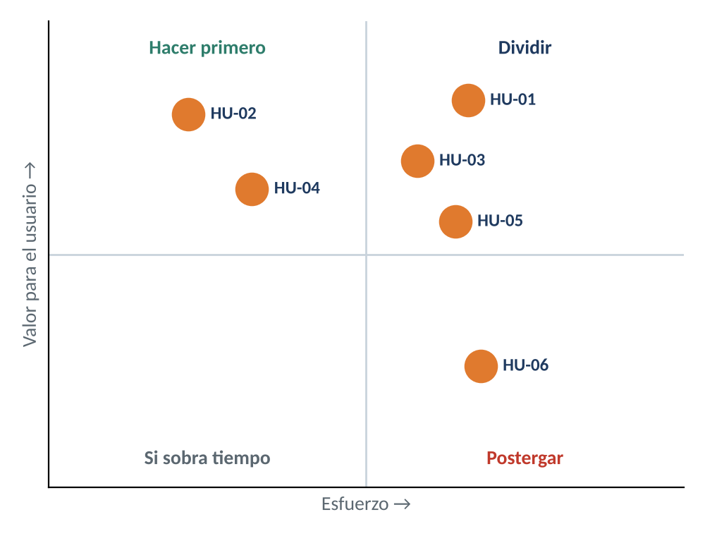

# Requisitos que se entienden {#sec-cap3}

::: {.callout-note .objetivos title="Al terminar este capítulo podrás"}
- Distinguir requisitos funcionales y no funcionales.
- Escribir historias de usuario con el formato «Como… quiero… para…».
- Redactar criterios de aceptación verificables con «Dado… Cuando… Entonces…».
- Evaluar una historia con los criterios INVEST y priorizar una lista de historias.
:::

::: {.callout-note .problema title="Problema de inicio"}
Doña Rosa pide: «Quiero que el programa me avise de los productos que se están acabando». Tres integrantes del equipo lo programan por separado. Uno muestra un aviso cuando quedan menos de 5 unidades; otro, cuando quedan menos del 10 %; el tercero envía un mensaje al celular. Los tres dicen que su versión es la correcta. ¿Quién tiene razón?
:::

## Qué es un requisito

Un **requisito** describe algo que el sistema debe hacer o una condición que debe cumplir. Sommerville (2011) distingue dos tipos:

- **Requisitos funcionales:** lo que el sistema hace. *«El sistema registra una venta con producto, cantidad y total.»*
- **Requisitos no funcionales:** condiciones sobre cómo lo hace: rendimiento, seguridad, facilidad de uso. *«El registro de una venta se completa en menos de 10 segundos.»*

En el problema de inicio nadie se equivocó al programar: se equivocaron antes, al no acordar qué significaba «se están acabando». La mayoría de los problemas de un proyecto de estudiantes nacen de un requisito que cada persona entendió a su manera.

## Historias de usuario

Una **historia de usuario** describe una funcionalidad desde el punto de vista de quien la usa, en una frase corta y en lenguaje del cliente (Cohn, 2004). El formato más usado es:

```text
Como <tipo de usuario>
quiero <una acción o funcionalidad>
para <el beneficio que obtengo>
```

La historia de Doña Rosa queda así:

```text
HU-04 · Aviso de stock bajo
Como dueña de la tienda
quiero ver qué productos tienen pocas unidades
para reponerlos antes de que se acaben
```

La tercera parte, el **para**, es la que más se olvida y la más importante: explica el valor de la historia y ayuda a decidir entre dos soluciones. Si el objetivo es reponer a tiempo, quizás un mensaje al celular sea demasiado y un reporte al abrir el programa sea suficiente.

Una historia no es una especificación completa. Es una promesa de conversación: la tarjeta resume la idea, y los detalles se acuerdan hablando con el cliente y se dejan escritos como criterios de aceptación.

## Criterios de aceptación

Los **criterios de aceptación** son las condiciones que debe cumplir la historia para considerarse terminada. Deben ser **verificables**: cualquier integrante tiene que poder comprobar si se cumplen, sin interpretar. Un formato útil es «Dado… Cuando… Entonces…», que describe un contexto, una acción y un resultado esperado:

```gherkin
Escenario 1: producto con pocas unidades
  Dado que el queso tiene 3 unidades y el mínimo es 5
  Cuando la dueña abre el reporte de stock
  Entonces el queso aparece en la lista de stock bajo

Escenario 2: producto con unidades suficientes
  Dado que la leche tiene 12 unidades y el mínimo es 5
  Cuando la dueña abre el reporte de stock
  Entonces la leche no aparece en la lista

Escenario 3: frontera
  Dado que el pan tiene exactamente 5 unidades y el mínimo es 5
  Cuando la dueña abre el reporte de stock
  Entonces el pan no aparece en la lista
```

Con estos tres escenarios, la discusión del problema de inicio desaparece: el mínimo es un número por producto, el aviso es un reporte y la frontera está definida. Fíjate en que el escenario 3 es un **caso límite**, la misma idea que viste en el Libro 1 al probar condiciones. En el capítulo 7, cada escenario se convertirá en una prueba automatizada.

## ¿Es una buena historia? Los criterios INVEST

Cohn (2004) propone revisar cada historia con seis criterios, conocidos por la sigla en inglés INVEST:

| Letra | Criterio | Pregunta para el equipo |
|---|---|---|
| I | Independiente | ¿Se puede desarrollar sin esperar a otra historia? |
| N | Negociable | ¿Deja espacio para acordar los detalles con el cliente? |
| V | Valiosa | ¿Aporta algo que el usuario reconoce como útil? |
| E | Estimable | ¿El equipo puede estimar cuánto trabajo lleva? |
| S | Pequeña (*small*) | ¿Cabe en una entrega de dos semanas? |
| T | Verificable (*testable*) | ¿Tiene criterios de aceptación que se puedan comprobar? |

: Criterios INVEST para evaluar una historia de usuario {tbl-colwidths="[18,30,52]"}


Una historia como *«Como usuario quiero que el programa sea fácil de usar»* falla en casi todo: no es estimable, no es verificable y es demasiado grande. Hay que dividirla o convertirla en requisitos concretos.

## Priorizar: no todo es para esta entrega

Una lista de historias siempre tiene más trabajo del que cabe en el tiempo disponible. Una forma simple de priorizar es ubicar cada historia según su **valor** para el usuario y el **esfuerzo** que requiere:

{width=88%}

Las historias de mucho valor y poco esfuerzo van primero. Las de mucho valor y mucho esfuerzo se dividen en historias más pequeñas. Las de poco valor y mucho esfuerzo se dejan para el final, o se descartan.

::: {.callout-warning .error title="Errores que vi como ayudante"}
**1. Historias escritas desde el programador.** *«Como programador quiero crear la tabla de productos.»* Eso es una tarea técnica, no una historia: no describe valor para el usuario. *Cómo evitarlo:* el «Como» siempre es alguien que usa el sistema.

**2. Criterios que no se pueden verificar.** *«El reporte debe ser rápido y claro.»* ¿Cuánto es rápido? ¿Claro para quién? *Cómo evitarlo:* si dos personas pueden discutir si se cumple, reescríbelo con números o ejemplos.

**3. Escribir los requisitos después del código.** El equipo programa y al final redacta las historias para el informe. *Por qué duele:* se pierde la única ventaja de escribirlas, que es ponerse de acuerdo antes. *Cómo evitarlo:* ninguna rama se crea sin una historia con criterios de aceptación.
:::

## Retos

::: {.callout-note .reto-basico title="Reto 3.1 · Básico"}
Reescribe estas frases como historias de usuario con el formato completo: *«Agregar productos»*, *«Ver las ventas del día»*, *«Contraseña para entrar»*. Decide tú quién es el usuario de cada una.
:::

::: {.callout-note .reto-intermedio title="Reto 3.2 · Intermedio"}
Escribe al menos tres criterios de aceptación con «Dado… Cuando… Entonces…» para la historia *«Como cajero quiero anular una venta para corregir un error de registro»*. Incluye un caso límite y un caso de error.
:::

::: {.callout-note .reto-desafio title="Reto 3.3 · Desafío · en equipo"}
Tomen el enunciado del proyecto de otra materia y conviértanlo en una lista de historias de usuario. Evalúen cada una con INVEST, ubiquen todas en una matriz de valor y esfuerzo y presenten al docente qué entregarían primero y por qué.
:::

::: {.callout-important .ia title="IA con criterio"}
**Pídele que critique tus historias, no que las escriba.** Un asistente es bueno encontrando ambigüedades:

*«Estas son mis historias de usuario con sus criterios de aceptación. Para cada una, dime qué criterio INVEST no cumple y qué pregunta debería hacerle al cliente para aclararla. No las reescribas.»*

**Verifica la respuesta:** las preguntas que te sugiera son para tu cliente, no para la IA. Si la IA «responde» por el cliente, estás inventando requisitos: la decisión final siempre se valida con quien va a usar el sistema.
:::

## Avance de MiTienda v2: la lista de historias

Esta es la primera versión de la lista priorizada de MiTienda v2. Cada historia tiene su número, que se usará en el nombre de la rama (por ejemplo, `hu-04-stock-bajo`).

| N.º | Historia | Valor | Esfuerzo |
|---|---|---|---|
| HU-01 | Como cajero quiero registrar una venta de varios productos para cobrar una compra completa. | Alto | Medio |
| HU-02 | Como dueña quiero ver el total vendido en el día para saber cómo me fue. | Alto | Bajo |
| HU-03 | Como dueña quiero agregar y editar productos del catálogo para mantener los precios al día. | Alto | Medio |
| HU-04 | Como dueña quiero ver qué productos tienen pocas unidades para reponerlos a tiempo. | Medio | Bajo |
| HU-05 | Como cajero quiero anular una venta para corregir un error de registro. | Medio | Medio |
| HU-06 | Como dueña quiero exportar las ventas del mes para entregarlas a mi contador. | Bajo | Medio |

: Lista inicial de historias de usuario de MiTienda v2 {tbl-colwidths="[10,58,16,16]"}


En la siguiente entrega, el equipo tomará las historias HU-02 y HU-04 (mucho valor, poco esfuerzo) y empezará a dividir la HU-01.

::: {.callout-note .resumen title="Resumen"}
- Los requisitos funcionales dicen qué hace el sistema; los no funcionales, cómo lo hace.
- Una historia de usuario tiene tres partes: quién, qué y para qué.
- Los criterios de aceptación verificables definen cuándo una historia está terminada.
- INVEST ayuda a detectar historias mal escritas; la matriz de valor y esfuerzo, a priorizarlas.
:::

::: {.callout-note title="Código QR"}
{width=15%} Plantilla de historia de usuario y tablero de prioridades
:::
